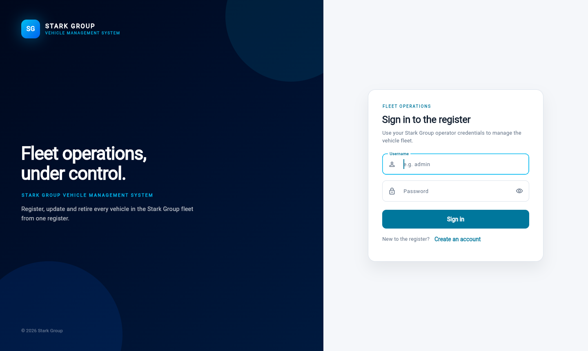
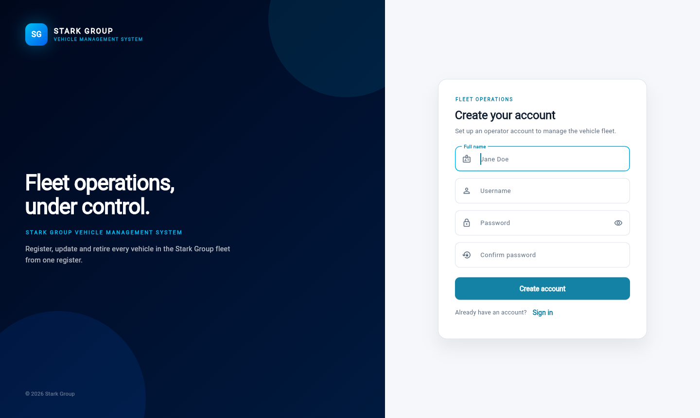
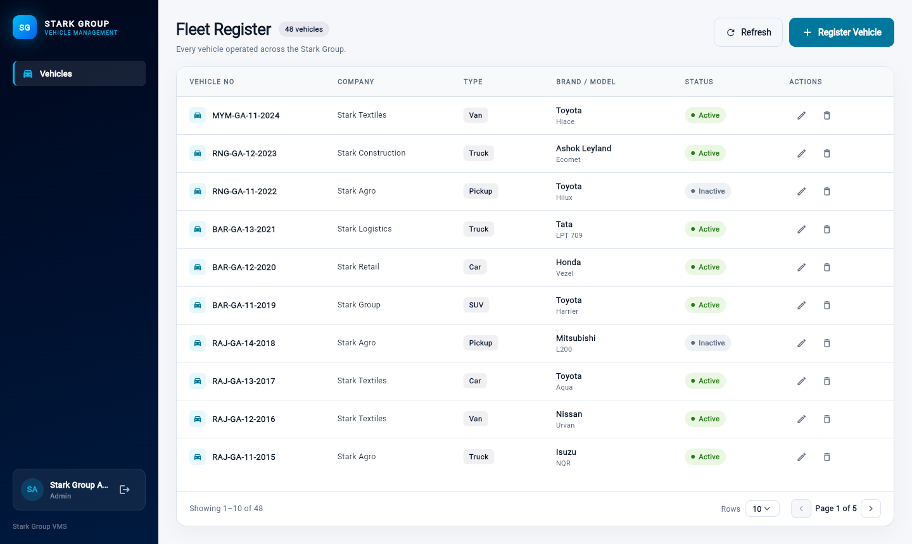

# Stark Group VMS — Flutter Web

The admin client for the Stark Group Vehicle Management System: sign in, browse
the fleet register, and register, edit or delete vehicles through a REST API.

| | |
|---|---|
| Framework | Flutter 3.50 (Dart 3.14), Material 3 |
| Target | Web |
| State | `StatefulWidget` + constructor injection (no third-party state manager) |
| HTTP | `package:http` behind a single `ApiClient` |
| Session | JWT in browser `localStorage` via `shared_preferences` |
| Deploy | Netlify (static bundle) |

The Spring Boot API this client talks to lives in a separate repository
(`vms-backend`). Nothing here contains backend code, database code or secrets.

## Screens

| Sign in | Create account |
|---|---|
|  |  |

| Fleet register (desktop) |
|---|
|  |

| Fleet register (mobile) |
|---|
|  |

- **Sign in** — username/password, inline error banner for rejected credentials.
- **Create account** — full name, username, password + confirmation; creates an
  operator and signs it in, so a fresh deployment is never locked out.
- **Application shell** — 250 px navy sidebar on wide screens, drawer + top bar on
  narrow ones, operator card with sign out.
- **Fleet register** — server-side pagination and sorting, status badges,
  `DataTable` on desktop and cards on tablets/phones, loading, empty, error and
  retry states.
- **Register / edit dialog** — local validation plus server-returned field
  errors (a duplicate vehicle number appears under the Vehicle number field).
- **Delete confirmation** — deletes only after the API confirms success.

Vehicle fields shown: **vehicle number, company, type, brand, model, status**.

## Run it

```bash
flutter pub get
flutter run -d chrome --dart-define=API_BASE_URL=http://localhost:8080
```

The backend must be running on the URL you pass. Local CORS already accepts any
`localhost` port.

Release build:

```bash
flutter build web --release --dart-define=API_BASE_URL=https://your-api.onrender.com
# output: build/web
```

## Configuration

| Build argument | Default | Purpose |
|---|---|---|
| `API_BASE_URL` | `http://localhost:8080` | Base URL of the Spring Boot API |

That is the only build-time configuration. No keys, tokens or credentials live
in the client; the JWT is obtained at sign-in and stored per browser.

## Tests

```bash
flutter analyze     # 0 issues
flutter test        # 47 widget + contract tests
```

The widget tests use `MockClient`, so no backend or browser is required. A real
browser end-to-end test is included for a running stack:

```bash
chromedriver --port=4444 &
flutter drive \
  --driver=test_driver/integration_test.dart \
  --target=integration_test/login_flow_test.dart \
  -d chrome \
  --dart-define=API_BASE_URL=http://localhost:8080
```

## Deploy to Netlify

`netlify.toml` is ready for a repository whose root is this folder:

1. Push this project to a GitHub repository (for example `vms-frontend`).
2. Netlify → **Add new site → Import an existing project** → pick the repo.
3. Build command `bash netlify-build.sh`, publish directory `build/web`
   (already set in `netlify.toml`).
4. Add environment variable **`API_BASE_URL`** = your Render API URL.
5. Deploy. `netlify-build.sh` installs Flutter 3.50.0 if the build image lacks
   it, then runs the release build.

Afterwards, set `APP_CORS_ALLOWED_ORIGINS` on the backend to this site's origin
so the browser is allowed to call the API.

## Project layout

```
lib/
  core/         config, theme, ApiClient, ApiException
  models/       User, Vehicle, VehiclePage
  services/     AuthService, VehicleService, SessionStore
  screens/      LoginScreen, VehiclesScreen
  widgets/      AppShell, VehicleFormDialog, ConfirmDeleteDialog,
                PaginationBar, StatusBadge, BrandMark
test/           47 widget + contract tests
integration_test/  real-browser end-to-end journey
web/            index.html, manifest, icons (PWA shell)
```
