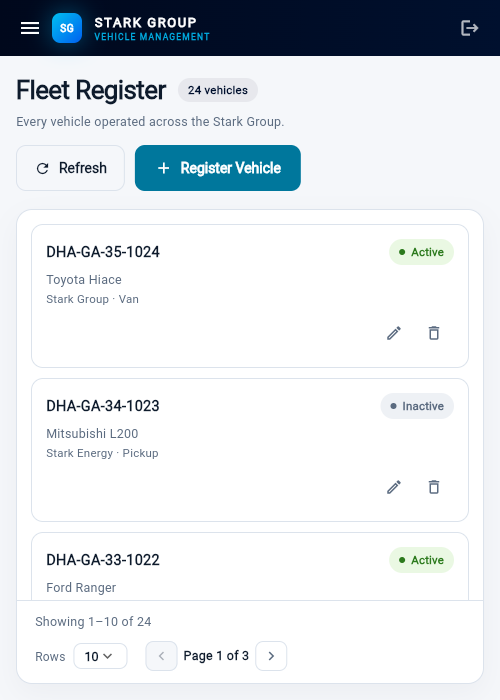

# Stark Group VMS — Flutter Web

The admin client for the Stark Group Vehicle Management System: sign in, browse
the fleet register, and register, edit or delete vehicles through a REST API.

| | |
|---|---|
| Framework | Flutter 3.50 (Dart 3.14), Material 3 |
| Target | Web |
| State | `StatefulWidget` + constructor injection (no third-party state manager) |
| HTTP | `package:http` behind a single `ApiClient` |
| Session | JWT in browser `localStorage` via `shared_preferences` |
| Deploy | Netlify (static bundle) |

The Spring Boot API this client talks to lives in a separate repository
(`vms-backend`). Nothing here contains backend code, database code or secrets.

## Screens

| Sign in | Create account |
|---|---|
|  |  |

| Fleet register (desktop) |
|---|
|  |

| Fleet register (mobile) |
|---|
|  |

- **Sign in** — username/password, inline error banner for rejected credentials.
- **Create account** — full name, username, password + confirmation; creates an
  operator and signs it in, so a fresh deployment is never locked out.
- **Application shell** — 250 px navy sidebar on wide screens, drawer + top bar on
  narrow ones, operator card with sign out.
- **Fleet register** — server-side pagination and sorting, status badges,
  `DataTable` on desktop and cards on tablets/phones, loading, empty, error and
  retry states.
- **Register / edit dialog** — local validation plus server-returned field
  errors (a duplicate vehicle number appears under the Vehicle number field).
- **Delete confirmation** — deletes only after the API confirms success.

Vehicle fields shown: **vehicle number, company, type, brand, model, status**.
